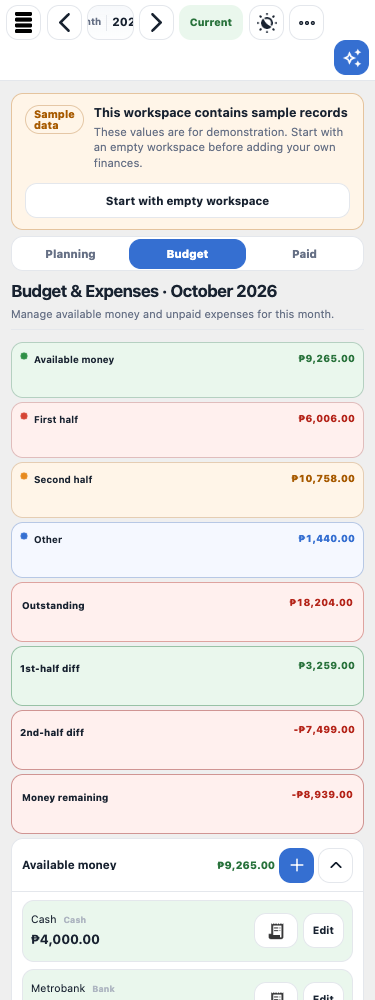
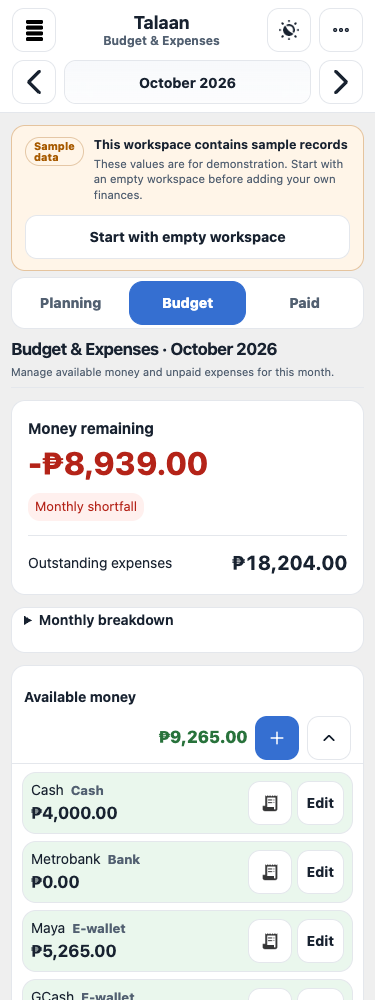

# Mobile budget priority summary

The Budget view puts Money remaining and Outstanding expenses first on phones and tablets. Monthly breakdown retains the existing period totals and half-month differences. Desktop keeps the expanded comparison layout.

The primary amount uses the approved 32px size to make the monthly position easy to find. The shared card radius is 14px, while controls retain their 12px radius. Primary phone actions use 44px touch targets. The system font and opaque light/dark surfaces preserve Talaan's existing quiet visual direction: ENERGY 1 / RHYTHM 1 / MOTION 1.

Month navigation has a dedicated phone row so the selected period does not compete with Menu, sync, or More tools. Add expense, Add income, and Add project remain available in their respective phone views. The closed phone drawer is inert; opening enables navigation, and closing restores focus to a visible trigger.

Theme-specific text colors improve account labels, report selection, project counts, and analytics comparisons. Larger record text can wrap rather than forcing amounts back into a smaller type size. Checkbox labels provide a larger interaction area without enlarging the native checkbox mark.

The screenshots use Talaan's labeled built-in sample workspace in isolated browser contexts. They contain no personal workspace data.

Before, at 375px:

After, at 375px:

Validation covers the existing financial totals, presentation-only disclosure changes, privacy masking, drawer focus, long amounts, phone targets, and both themes at phone, tablet, and desktop widths. See `tests/browser/budget-priority-accessibility.spec.mjs`.

The application stays on V2.5.0, Finance Schema 12, and Cloud Schema V3. The UI asset refresh advances to `finance-ui-hotfix-v2-0-1-talaan10`; the existing finance cache identity is retained.
