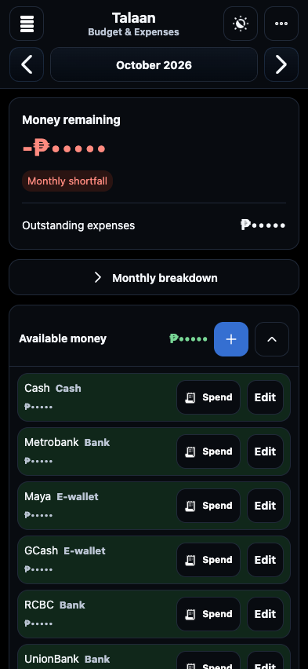
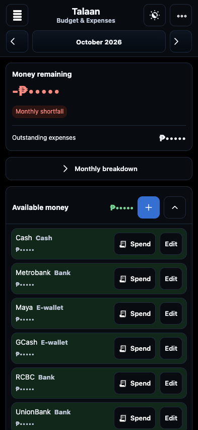
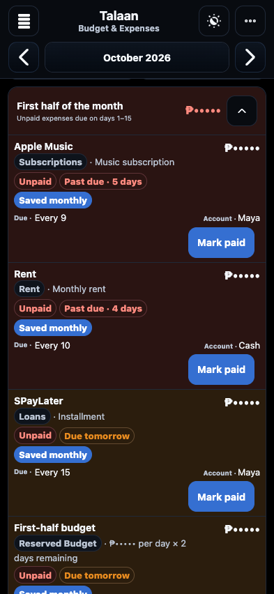
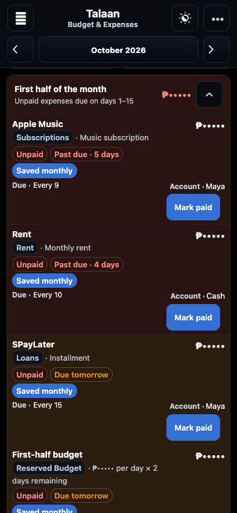
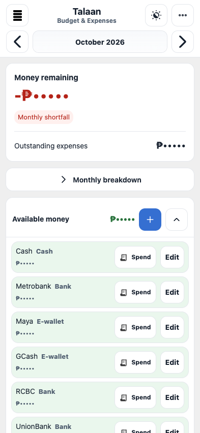
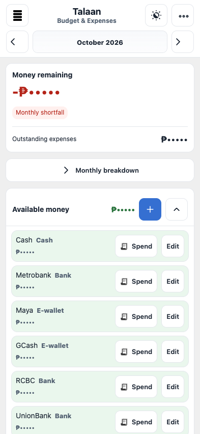
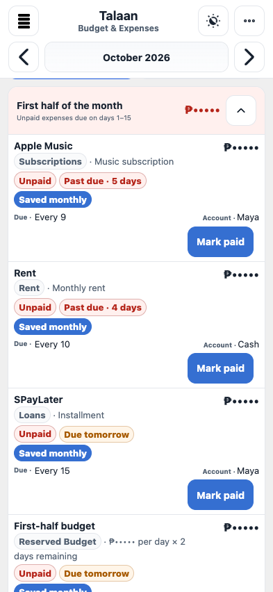
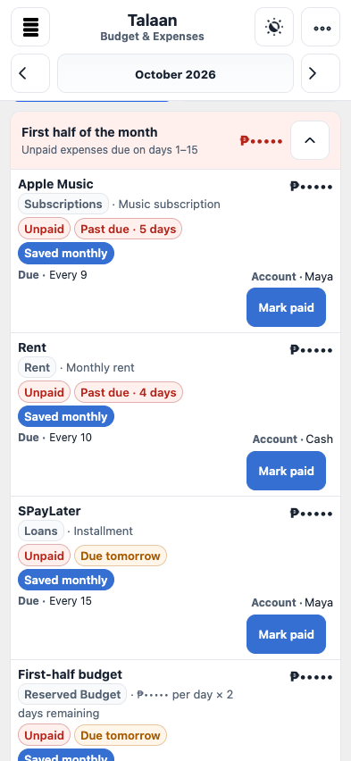

# Compact phone scale

Approved audit findings 18–21, 14 October 2026. This change shares the phone type scale across Dashboard, Income & Planning, Budget & Expenses, Paid Expenses, Projects, Project Payments, Reports/Insights, Settings, and forms. It keeps compact desktop geometry separate from touch landscape.

| Role | Phone size |
|---|---:|
| Page heading | 16px |
| Section and record title | 14px |
| Action and field label | 13px |
| Supporting copy | 12px |
| Editable input | 16px |
| Ordinary amount | 16px |
| Budget outstanding total | 18px |
| Budget remaining amount | 28px |
| Effective tap area | At least 44px |
| Control / card / dialog corner | 10px / 12px / 16px |

`assets/css/phone-scale.css` owns the type and touch rules, including legacy span annotations and generated Due/Account prefixes. The canonical radius stylesheet owns responsive corner tokens. Portrait applies at up to 700px; coarse-pointer layouts retain the shared scale up to 932px, including iPhone landscape. Native checkbox drawings stay small inside larger labels, and calendar cells retain event space. Hidden swipe controls remain hidden until keyboard focus exposes their alternative. State changes and financial behavior are untouched.

The UI refresh key advances to talaan13; the phone stylesheet gets a content-hashed query shared by the document and offline shell. Application V2.5.0, Finance Schema 12, Cloud Schema V3, persistent storage, and cache identity are preserved.

## Visual evidence

Screenshots use isolated sample records with masked amounts at 393×852. They show the actual merged baseline and the implemented styles, without prototype styling. The sample setup notice and offline-only notification are omitted from these sizing comparisons.

| Area | Before | After |
|---|---|---|
| Summary and accounts, dark |  |  |
| Expense rows, dark |  |  |
| Summary and accounts, light |  |  |
| Expense rows, light |  |  |

## Verification

The new regression checks cover shared copy sizes and form targets across the eight screens, portrait at 393×660 and 393×852 in both themes, landscape rotation with active month navigation, toolbar containment, and fine-pointer desktop boundaries at 1024, 1440, and 1920px. Existing alignment, header wrapping, disclosure, swipe, finance, and sync checks also run. Physical iPhone Safari, keyboard insets, and increased iOS text size require device verification.
