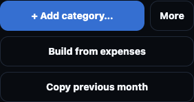

# iPhone Budget header and action alignment

The approved change compacts Budget headers and aligns their totals and controls at a 393px CSS viewport. Available money and the half-month sample headers measure 69px high; Other expenses measures 71px. Collapse controls retain 44 × 44px targets and 12px corners. Action gaps are 8px. Long content can wrap rather than force a fixed header height.

Screenshots use an isolated sample workspace with financial amounts masked. Before images render the main-branch stylesheet; after images render the proposed stylesheet. Both use the same iPhone 14 Pro device profile at 393 × 852, in Chromium-based Brave, with CSS-scale screenshots. These are not physical iOS Safari screenshots.

## Available money

Before:

After:

## First half of the month

Before:

After:

## Second half of the month

Before:

After:

## Other expenses

Before:

After:

## Repeated expense actions

Before:

After:

## Planning actions

Before:

After:

## Validation scope

Header regressions check both 393 × 660 and 393 × 852 in light and dark themes, expanded and collapsed states, keyboard activation, SVG/button centering, actual action gaps, and label containment. Additional cases exercise long section names and financial amounts at 320px and double-sized text. Button regressions cover 375, 393, and 430px in both themes, including complete Planning labels, compact expense actions, centered text/icons, and reachable dialog actions.

The change retains V2.5.0, Finance Schema 12, Cloud Schema V3, financial mutations, storage keys, and finance cache identity. The existing one-time UI asset refresh advances to talaan11. Real iOS Safari and its keyboard remain unverified.
