# Phone header consistency

Implemented audit findings 22–24 for the compact phone layout. Amounts are masked sample data in an isolated browser. The screenshots show the actual generated runtime at 393 × 852; no proposed styles are injected in the after captures.

- Center month arrows inside the existing 44px controls.
- Hide editing actions while the planner is collapsed; use full-width Build and Copy rows when expanded.
- Place annual-income copy above Year/Show all and Export, with 8px action gaps.
- Preserve the compact three-column summary, current type scale, corner tokens, financial calculations, and schemas.

## Dark theme

| Area | Before | After |
| --- | --- | --- |
| Month navigation |  | 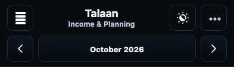 |
| Collapsed planner | 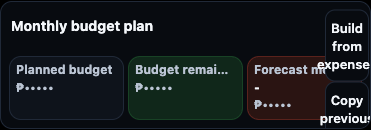 | 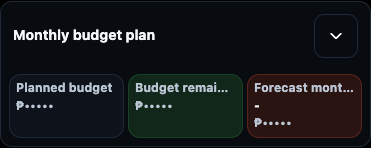 |
| Expanded actions | 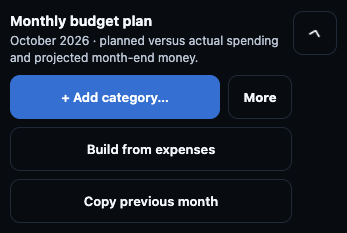 | 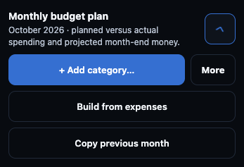 |
| Annual header | 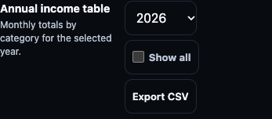 | 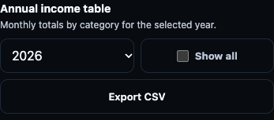 |

## Light theme

| Area | Before | After |
| --- | --- | --- |
| Month navigation | 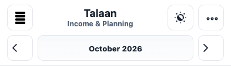 | 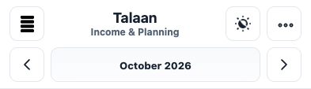 |
| Collapsed planner | 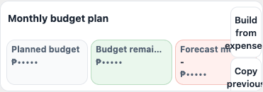 | 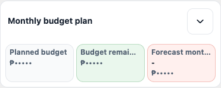 |
| Expanded actions | 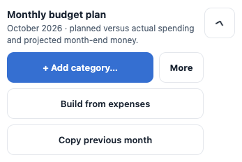 | 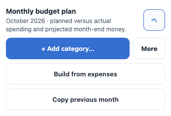 |
| Annual header | 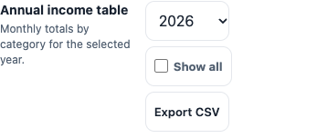 | 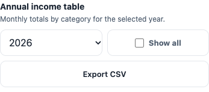 |

Stateful regression coverage: `tests/browser/phone-header-consistency.spec.mjs` checks SVG/text centers, painted-text containment, collapsed actions, saved state through reload, keyboard operation, annual controls, Build/Copy behavior, rotation, and the phone/mouse breakpoint.
