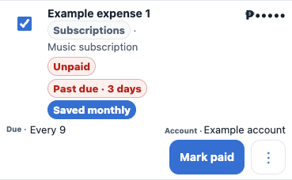
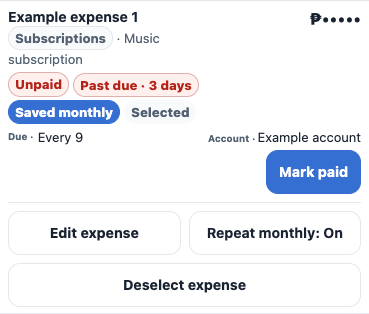
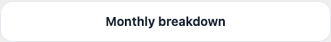
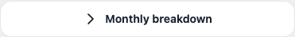
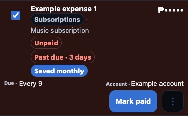
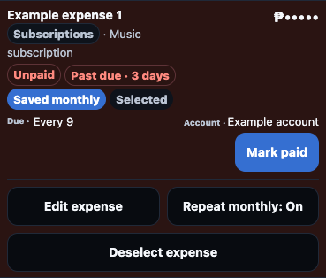

# Phone expense swipes and Monthly breakdown

The Budget view replaces the visible per-expense checkbox and More button on phones with two gestures. Swipe right selects or deselects an unpaid expense for the existing bulk actions; swipe left opens its secondary actions inside the row. Swiping alone does not pay an expense, edit it, or change recurrence.

Keyboard users can focus a row and press Space to select or Enter to open actions. The accessible Actions button appears when focused and includes a Select/Deselect action. Desktop checkboxes and actions retain their existing layout. The Paid Expenses menu uses bounded viewport coordinates on phones so percentage offsets cannot place it above the screen.

Monthly breakdown retains the native details interaction and centers its arrow and label together, with an 8px gap.

## Visual comparison

These images use an isolated sample workspace with placeholder expense and account names and masked amounts. The before images render the main-branch HTML, expense stylesheet, and interaction script; the after images render this branch. Both use the iPhone 14 Pro profile at 393 × 852 in Chromium-based Brave, captured at CSS scale. They are not physical iOS Safari screenshots.

The expense is selected and its secondary actions are open in both revisions. In the before revision, the popup is positioned above the viewport and is absent from the row image. In the after revision, the actions remain inside the row.

| Light theme before | Light theme after |
| --- | --- |
|  |  |
|  |  |

| Dark theme before | Dark theme after |
| --- | --- |
|  |  |
|  |  |

## Validation

Gesture regressions cover selection counts and badges, filter clearing, interrupted and short gestures, ignored interactive controls, native touch input, vertical scrolling, keyboard alternatives, menu focus restoration, outside taps, another open row, long content, explicit recurrence actions, and the existing payment confirmation. Geometry checks cover 375, 384, 388, 393, and 430px in both themes, with centered Monthly breakdown at 393 × 660 and 393 × 852. Existing desktop, finance, privacy, sync, restore, and PWA tests remain part of the full suite.

V2.5.0, Finance Schema 12, Cloud Schema V3, and the finance cache identity remain unchanged. The one-time UI refresh advances to `finance-ui-hotfix-v2-0-1-talaan12` and includes the changed HTML, interaction script, and expense stylesheet.

Physical iPhone Safari and VoiceOver validation remains a device check after deployment.
